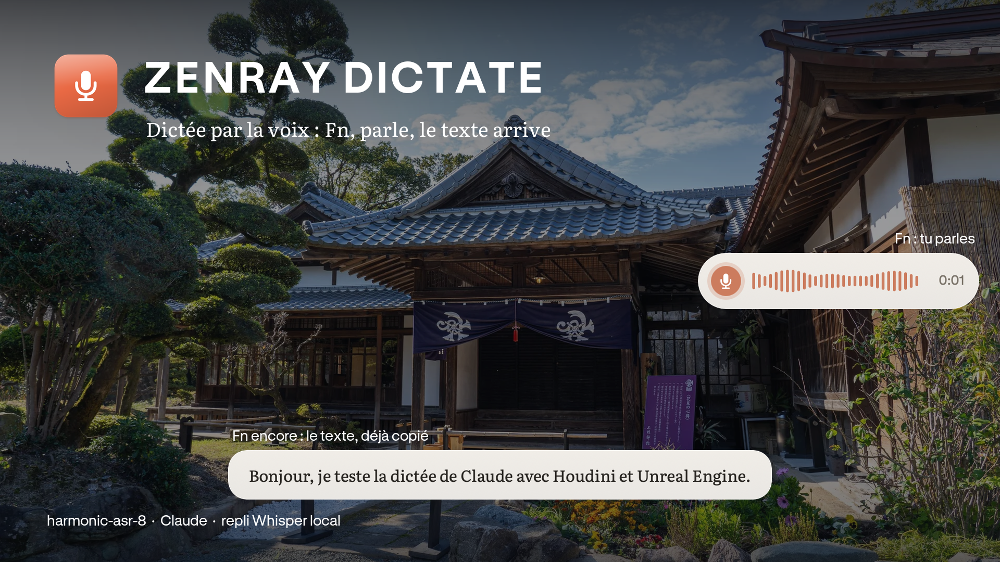
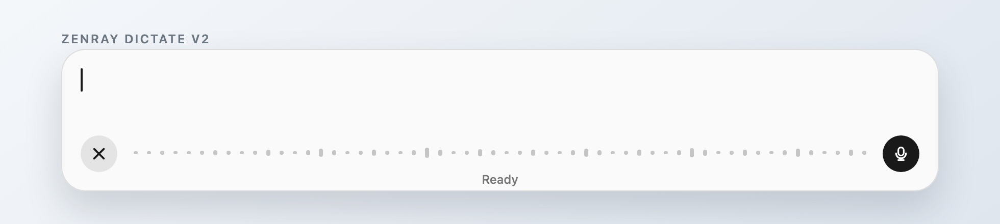

## 26 October 2026: GT Ultra, Literata and GT Standard L by default (version 3.16)

The received text of the card is set in Literata. Titles and every number (the timer, the title of the presentation sheet) are set in GT Ultra Regular, free case and no imposed letter spacing; the rest of the interface (buttons, labels) is GT Standard L Regular. They are the default fonts; GT Sectra, Anthropic Serif and Inter stay valid alternatives. The four font names are `ClaudeOverlay.Tokens.titleFont`, `textFont`, `uiFont`, `numberFont`, and `build.sh` bundles the drawings. `Scripts/MakeSheet.py` carries the same choice in `PARAMS`. (26 October 2026)

## 26 October 2026: red interface for the local Whisper, silence gate and new icon (version 3.15)

The interface tells which engine answers. Claude is terracotta; whenever the local Whisper takes over, the capsule and the card turn red (tint, border, microphone button, waveform): from the first second if the engine is local or Claude is known to be down, and the moment the fallback starts otherwise (`ClaudeOverlay.Theme`, values in `ClaudeOverlay.Tokens`, `localAccent` `#D62828`). Proven in the real flow with a dead Claude server: the capsule stays terracotta while recording, turns red when `health: local Whisper fallback used` is logged, and the card is red (`docs/widgets/real-flow-whisper-fallback-sequence.png`). `ZenRayDictate --overlay-preview local` shows the red widgets without speaking. (26 October 2026)

Silence gate: a recording whose peak is under -42 dBFS is never sent to the local engines (`AudioLevel.swift`), because Whisper invented « Thank you. » and « Mm. » on a recording peaking at -44.8 dBFS; the card says « Rien entendu » and no recording is kept. (26 October 2026)

The app icon uses the base colour `#e96944` with the same gradient as before (top toward white, bottom darker), rendered by `Scripts/RenderClaudeIcon.swift`. `Scripts/MakeSheet.py` builds the presentation sheet of the two orange widgets (`docs/ZenRayDictate-sheet.png`, the header above and the ZenRay Assets project thumbnail); the captures are in `docs/widgets/`. GitHub offers no API for a repository's social preview image, so the sheet is the README header. (26 October 2026)

## 26 October 2026: making the dictation durable (version 3.14)

The Claude dictation endpoint is not an official API: it was found by reverse engineering on 25 October 2026, so it can change without notice. Version 3.14 assumes that and adds three safeguards. (26 October 2026)

1. Local Whisper fallback, on by default (`allowLocalFallback`, enabled in Matthieu's library on 26 October 2026 after a backup, `Library.json.backup-26-October-2026`). When Claude fails for any reason except silence (expired sign-in that cannot be renewed, changed protocol, offline, server busy, no answer within 45 s), the local Whisper transcribes the recording instead of showing an error. Silence never falls back, because Whisper invents words on silence. The local engine now has a 90 s limit. Measured with `ZenRayDictate --transcribe-pipeline <file> --dead-server`: without the fallback the dictation fails after 1.1 s; with it, Whisper answers after 3.2 s (quality is lower, as measured on 25 October 2026). (26 October 2026)
2. Health monitor (`ClaudeHealth.swift`): at launch (after 15 s), every 6 hours and 8 s after each wake, the app opens a real session with 0.6 s of silence and checks that it is accepted and closes cleanly. The result and the last Whisper fallback appear in the menu-bar tooltip and in the log (`health:` lines). Busy or offline never raise an alarm. `ZenRayDictate --health` runs one check; `--health --wrong-path` simulates a moved endpoint and reports « HTTP 404 ». (26 October 2026)
3. Regression tests: 32 `swift test` cases cover the sign-in renewal, the 401 classification, the typed failures, the keyterm bounds, the health verdicts, the silence rule and the deadline. (26 October 2026)

If Claude dictation stops working, read the tooltip of the menu-bar icon first, then the `health:` lines of `~/Library/Logs/ZenRayDictate.log`. A rejected sign-in is renewed by `claude -p ok --model haiku`; if that fails, run `claude /login` in a terminal. (26 October 2026)

## 26 October 2026: expired Claude sign-in, the « bad response from the server » failure

Version 3.13 fixes the failure « There was a bad response from the server. Recording saved for retry. ». Cause, proven: the Claude OAuth token that the engine reuses lasts about 8 hours (`expiresAt` in the keychain item `Claude Code-credentials`: 01:10 on 26 October 2026, read at 11:11). An expired token makes the server answer HTTP 401 at the WebSocket upgrade, which macOS reports as `NSURLErrorBadServerResponse`; the old code cached the token for the whole session and renewed it only on an in-band error frame, so it never renewed. (26 October 2026)

`ClaudeCredentials.swift` now reads the token with its expiry, renews it through the Claude CLI (`claude -p ok --model haiku --no-session-persistence`, run in a neutral temporary folder with a 45 s timeout) when it is within 2 minutes of expiry, and shares one renewal between concurrent callers. A background check every minute (cache only until the last 15 minutes) and after each wake renews it when less than 280 s remain: the Claude CLI renews a token only inside its own 5-minute buffer (`now + 300000 >= expiresAt`, read in the Claude Code 2.1.308 binary), so an earlier call is a useless model call. Pressing Fn therefore never waits. If the token is expired at the moment of the press, the app records to a file, renews meanwhile and transcribes the file. A token that looks valid but is rejected (HTTP 401 or 403) is forgotten and force-renewed once. (26 October 2026)

Every failure is now typed (`ClaudeDictationFailure`) with a message that says what to do: sign-in expired (`claude /login`), too many sessions (retried after 1.5 s), offline (retried once), nothing heard. A connection lost during the recording never returns a partial text as final: the full recording is transcribed again from the file. A rewrite failure in a custom mode keeps the raw transcript. The error card offers « Réessayer » for the saved recording. A socket opened for a recording that fails to start is closed. Keyterms skip entries over 40 characters and stay under 1500 characters in total. (26 October 2026)

Measured: with the real expired token, `ZenRayDictate --transcribe` renewed the sign-in and transcribed in 7.5 s (new expiry 19:18); with `--bad-token` (a rejected token valid by the clock) it recovered in 4.7 s; a live session with a rejected token reports « Connexion Claude refusée » instead of « no text ». `swift test` passes 28 tests; removing the single-flight guard or the 2-minute skew turns two of them red. (26 October 2026)

## 25 October 2026: text-only result card

Version 3.12 removes the « Transcription » title and the action row at Matthieu's request: the card at the bottom centre shows the text alone, already copied, and its width follows the text from 240 to 640 pt. `ClaudeOverlay.Tokens.showTitle` and `showActions` bring them back. Measured on the preview sentence: card 575 × 49 pt, centred (x 576), 24 pt above the Dock. `Scripts/ShadowCheck.py` is calibrated for the capsule; on this shorter card the downward shadow darkens the lower corners to 232 without any square. (25 October 2026)

## 25 October 2026: live Claude stream and capsule-shaped shadow

Version 3.11 streams audio while Matthieu speaks, as claude.ai does. The WebSocket opens when Fn is pressed (`ClaudeLiveSession` in `ClaudeVoiceTranscriber.swift`), each 16 kHz PCM16 chunk from `AudioCapture.onPCM16` is sent at once, and `forward_interims=typed` returns `TranscriptInterim` frames during speech. At the second Fn press only `CloseStream` remains: the card opens immediately with the text already received, then its text is replaced in place by the final transcript. The OAuth token is read once and kept in memory. If the live session fails, the recorded file is transcribed as before. (25 October 2026)

Measured with `ZenRayDictate --live-latency <audio file>`, which streams a file at real-time pace: live text ready 0 ms after the stop for the French, Japanese and English clips; final text after 438, 362 and 297 ms, then 471 ms on a second French run. The final delay is the server's end of processing. With `language` set to `auto`, Japanese interims arrive in romaji and become kana with the final text; with `language` set to `ja` they arrive in kana. (25 October 2026)

The square around the capsule was the window shadow, computed as a rectangle. `NSVisualEffectView` ignores the layer corner radius, so `maskImage` now cuts the real capsule and card shapes, and the shadow is recomputed after each display. `Scripts/ShadowCheck.py <window capture>` reads the darkest pixel around each corner of the body: 224 on version 3.10 (square), 241 on version 3.11 (capsule); it exits 1 under 235. (25 October 2026)

## 25 October 2026: B1 « Papier crème » overlay and I1 Claude icon

Version 3.10 replaces the old bottom capsule of the native flow with the design Matthieu chose, B1 « Papier crème » in Liquid Glass (`Sources/ZenRayDictate/ClaudeOverlay.swift`). Pressing Fn shows a 300 × 60 pt cream glass capsule 16 pt from the right edge, vertically centred on the visible screen: a terracotta button with the SF Symbol `mic.fill`, a live terracotta waveform and a timer in Anthropic Serif. Pressing Fn again stops the recording; the capsule dims while Claude transcribes. (25 October 2026)

The text then appears in a 640 pt card at the bottom centre, 24 pt above the Dock: a title in GT Sectra LCG italic, the text in Anthropic Serif 17 pt, and three SF Symbol actions, `doc.on.doc` Copié, `return` Insérer and `arrow.clockwise` Refaire. The text is always copied to the clipboard. « Insérer » pastes it into the field that had focus when Fn was pressed; the panels never take keyboard focus. A click outside the card fades it in 0.18 s. Setting `autoInsert` (Settings, « Also paste the text into the focused field ») restores automatic pasting; it is off by default. (25 October 2026)

Every value of the design lives in `ClaudeOverlay.Tokens`. Design file: `/Users/zenray/.claude/skills/zenray-edit/designs/2026-10-25-zenray-dictate-papier-verre/index.html`. (25 October 2026)

The app icon is I1: a terracotta squircle with a glass highlight and the white SF Symbol `mic.fill`, rendered by `Scripts/RenderClaudeIcon.swift`; the former Gemini star is archived in `docs/icons-proposals/archive-gemini-25-October-2026/`. (25 October 2026)

Verification: `ZenRayDictate --overlay-preview` shows the capsule for 4 s, then the card for 6 s, with synthetic levels. Measured window bounds on a 1728 × 1117 pt screen whose visible frame starts 75 pt above the bottom: capsule at x 1412, width 300 (right edge 1712, so 16 pt from the edge), vertical centre 538 pt for a visible centre of 537.5 pt; card at x 544, width 640 (centred), bottom edge 24 pt above the visible frame. `swift test` passes 15 tests. A spoken dictation with the physical Fn key still needs a manual check. (25 October 2026)

## 25 October 2026: Claude speech-to-text engine (harmonic-asr-8), now the default

Version 3.9 adds the `claude` engine (`Sources/ZenRayDictate/ClaudeVoiceTranscriber.swift`) and makes it the default. Each recording is converted to 16 kHz mono PCM16 and streamed to `wss://api.anthropic.com/api/ws/speech_to_text/voice_stream`, the WebSocket used by claude.ai, Claude Desktop and Claude Code dictation. The query parameter `announce_provider=true` makes the server name its model; on 25 October 2026 it answers `harmonic` / `harmonic-asr-8`. (25 October 2026)

Authentication reuses the Claude Code OAuth token stored in the keychain item `Claude Code-credentials`, read with `/usr/bin/security`. A rejected token is refreshed once by `claude -p ok --model haiku`, then the request is retried. A language of `auto` sends no `language` parameter: the server refuses the value `auto`, and without a language it detects French, English and Japanese on its own. (25 October 2026)

Settings: `Claude provider` (empty for the server default, `nova3` for Deepgram Nova-3), `Claude keyterms` (comma-separated bias words; the written forms of the vocabulary rules are added, up to `claudeKeytermLimit`), `Claude voice server`, and `Claude CLI used to refresh the sign-in`. Gemini, Whisper and Parakeet remain selectable. The Gemini live capsule is used only when the engine is `gemini`. Cloud text modes with a prompt still call Gemini for rewriting; the default `verbatim` mode does not. (25 October 2026)

Measured on the first 25 FLEURS test clips per language, streamed through the same endpoint (word error rate for English and French, character error rate for Japanese): harmonic-asr-8 2.96 %, 4.40 %, 1.22 %; Nova-3 9.63 %, 10.51 %, 8.28 %; local Whisper large-v3-turbo 5.56 %, 6.82 %, 5.03 %. FLEURS is public, so the model may have seen these clips during training. Method and scripts: `/Users/zenray/.claude/tmp/tmp-claude-stt-probe-25-october-2026/`. (25 October 2026)

Verification: `ZenRayDictate --transcribe <audio file>` runs the configured Claude engine without the interface and prints the provider and the text. It transcribed a French, a Japanese and an English clip correctly in 1.8 to 3.0 seconds. An invalid audio file exits with code 1 and an error message. `swift test` passes 15 tests, including the new default engine and the keyterm deduplication. This is an unofficial endpoint, so Anthropic can change it without notice. (25 October 2026)

## 10 October 2026: Input-only AUHAL microphone bridge, AirPods Pro compatibility, and MacBook Pro or iPhone microphone selection

Version 3.8 replaces WebKit's native live microphone capture (`VoiceProcessingIO` / `AUVPAggregate`) with `NativeMicrophoneBridge`, a standalone CoreAudio `AUHAL` (`kAudioUnitSubType_HALOutput`) bound strictly in input-only mode (`enableInput = 1` on bus 1, `disableOutput = 0` on bus 0) to the selected physical input device (`MacBook Pro Microphone` or `iPhone Continuity Microphone`). WebKit's `getUserMedia` previously created a `VPAUAggregateAudioDevice` combining the input microphone and the `AirPods Pro` output (`2014 4c`), which ducked output audio to 17% and failed with `VoiceProcessor failed to run downlink DSP (state fault)` (`Error code 1937006964 'stft'`). With `NativeMicrophoneBridge` streaming `16 000 Hz` PCM16 chunks (`640` samples per 40 ms frame) into `AudioContext.createMediaStreamDestination()` via `GeminiBridge.js`, WebKit never instantiates `VoiceProcessingIO` and never touches Bluetooth output on `AirPods Pro`, `Sony WH-1000XM3`, or `Sony WH-1000XM5`. (10 October 2026)

`MicrophoneManager` and `MicrophoneSwitcherView` remove the forced built-in lock (`LockToBuiltIn`) and the external `nomicswitch` daemon that previously prevented selecting the iPhone microphone. Users can freely select either `MacBook Pro Microphone` (`BuiltInMicrophoneDevice`) or `iPhone Microphone` (`ContinuityMicrophone`) from the orange menu-bar pill switcher or macOS Sound Settings, and the choice persists in `ZenRayDictate.PreferredInputUID`. Whenever a Bluetooth headset (`AirPods Pro`, `Sony WH-1000XM3`, `Sony WH-1000XM5`) connects or triggers in-ear detection and attempts to hijack `kAudioHardwarePropertyDefaultInputDevice`, `MicrophoneManager.ensurePreferredNonBluetoothInput()` automatically restores the user's chosen `MacBook Pro` or `iPhone` microphone with immediate, 200 ms, and 600 ms checks. Switching microphones while recording hot-swaps the `AUHAL` unit on the fly. (10 October 2026)

Verification: `Scripts/VerifyMicrophoneAndAirPodsFix.swift` verifies bidirectional persistence for both `iPhone Microphone` and `MacBook Pro Microphone`, simulated Bluetooth hijack restoration, and live `AUHAL` PCM16 streaming on both inputs. `Scripts/VerifyLiveNativeMicGemini.swift` verifies end-to-end live `AUHAL` capture into `GeminiWebTranscriber` on both `MacBook Pro Microphone` (`125` chunks) and `iPhone Microphone` (`108` chunks) with `0` `VoiceProcessor` faults in `com.apple.WebKit.GPU`. Three consecutive real-world dictations with `AirPods Pro` in-ear confirm automatic clipboard completion (`30`, `61`, and `60` characters). (10 October 2026)

## 9 October 2026: Compact orange microphone pill and fullscreen window fix

`AppDelegate`, `MicrophoneManager`, and `MicrophoneSwitcherView` add a compact `32 x 20` point pure Apple orange (`#FF8000`) menu-bar status pill displaying a centered white `mic.fill` icon (`NSStatusItem`). Hovering shows the active microphone name in the tooltip, and left-clicking opens the native SwiftUI microphone switcher popover showing each available microphone, its transport badge (`Intégré`, `iPhone`, `USB`, `Bluetooth`), and its live sample rate (`48 000 Hz`). (10 October 2026)

`GeminiWebTranscriber` fixes a macOS fullscreen interference bug where YouTube and Chrome kept the top menu bar and traffic-light title bar visible in fullscreen. Previously, the hidden `sessionWindow` stayed ordered front at floating level (`Layer 3`) with `.canJoinAllSpaces` and `.fullScreenAuxiliary` while `alphaValue = 0`. Calling `sessionWindow.orderOut(nil)` whenever the composer is hidden removes the invisible floating window from WindowServer (`0` active windows when idle) and restores clean macOS fullscreen spaces. (10 October 2026)

## 4 October 2026: Immediate 0.1 s out / 0.1 s in result transition

Version 3.6 build 9 begins the right-to-bottom-center transition as soon as the microphone stops. It fades out for 0.1 seconds, relocates while transparent, then fades in for 0.1 seconds. The final real Gemini witness measures 0.203240 seconds between animation start and completion, including AppKit scheduling. (4 October 2026)

The 900 ms transcript-stability guard still protects clipboard/history completion, but no longer delays the visible result. Late Gemini edits update the same native DOM in the bottom-center capsule. Clicking outside can dismiss this result while final text settles; completion does not reopen a dismissed capsule. Recording remains visible at right and cancelled/interrupted animations cannot relocate a newer capture. (4 October 2026)

Real physical Fn is now confirmed by AppKit global press, Gemini start/stop and clipboard logs in Chrome at 10:20:30/10:20:40 and Codex at 10:22:31/10:22:35. Both sequences run with appActive=false. (4 October 2026)

## 4 October 2026: AppKit Fn monitoring replaces the disabled Quartz tap

Version 3.5 build 8 removes the Quartz event tap. The running app measured accessibility=true but quartzListenAccess=false; the previous listener repeatedly stayed disabled despite four re-enable attempts per second. The old started=true log therefore did not prove effective global listening. (4 October 2026)

Permanent NSEvent global and local monitors now cover other apps and ZenRayDictate respectively, with a shared edge detector and missed-release recovery. Runtime startup confirms local=true, global=true and accessibility=true. The capture window and focus handling remain unchanged. (4 October 2026)

Four Fn tests, including local-to-global transition with duplicate down events, pass together with ten library tests and signed bundle verification. Physical Fn from Codex is being verified with the user; monitor installation alone is not proof of keyboard delivery. Apple documents both monitors as necessary for coverage of own and other applications: https://developer.apple.com/library/archive/documentation/Cocoa/Conceptual/EventOverview/MonitoringEvents/MonitoringEvents.html (4 October 2026)

## 4 October 2026: Permanent Fn recovery across focus changes

Version 3.4 build 7 retains a global Fn event tap while the app runs. A 250 ms health check in the common run-loop modes re-enables disabled taps, replaces invalid taps and clears a pressed state when a release was missed. Only physical Fn modifier events trigger capture; checking health never invents a press. Press events and listener recovery are recorded in ~/Library/Logs/ZenRayDictate.log. (4 October 2026)

The Gemini web view uses the public inactiveSchedulingPolicy.none setting so its capture observers and completion timers continue running while inactive. Recording remains visible at right; final text is copied and shown bottom center, then outside-click fade is enabled. (4 October 2026)

Three Fn state tests reproduce a missed-release lock, verify recovery, prevent duplicate held-key presses and reject invented presses. The real Gemini witness probe explicitly deactivates the application before starting and again during capture, then verifies Fn start/stop, visible native waveform and automatic clipboard completion with appActive=false. (4 October 2026)

## 4 October 2026: Visible recording and bottom-center result

Version 3.3 build 6 supersedes the hidden-recording behavior below. Fn starts capture with the real Gemini capsule and native waveform visible at the right edge (340 points wide). The capsule stays visible throughout recording and finalization, even when another application is clicked. Releasing Fn keeps capture active; the next Fn activation stops it. (4 October 2026)

After Gemini finishes, the text is copied automatically and remains visible in a 720-point capsule at the bottom center, 24 points above the available screen edge. Clicking outside fades this completed result away. Idle startup remains hidden; the icon opens the preview. (4 October 2026)

## 4 October 2026: Hidden Fn toggle and automatic clipboard

Version 3.2 starts with the Gemini composer hidden. Press Fn once to start the website microphone and once again to stop; releasing Fn keeps recording. Completed dictation is copied automatically to the clipboard and saved in history without retaining audio. Each capture waits for Gemini's final text before copying. Cancellation copies nothing. (4 October 2026)

Left-click the menu-bar icon to open or hide the real Gemini capsule. The preview is 340 points wide, vertically centered at the right edge, with automatic height up to 460 points. Clicking outside fades it away in 0.18 seconds while an active capture continues invisibly. Right-click the icon for settings and the full Google session. Control+D also toggles capture; Control+Q cancels. This section replaces the historical hold-to-talk instructions below for direct Gemini dictation. (4 October 2026)

The native Gemini waveform and built-in MacBook microphone lock remain in use. Whisper, Parakeet and local-only workflows retain their native route. No benchmark is performed. (4 October 2026)

Verification: `node Scripts/VerifyComposerCapture.mjs` checks delayed final text, exactly one completion, separate captures, unchanged drafts, busy requests and cancellation. `Scripts/VerifyFnCapture.swift` exercises the production Fn handlers against real Gemini with synthetic witness audio in a debug verification bundle. Its proof confirms hidden capture, release remaining active, second activation stopping, clipboard completion, right positioning and fade. The physical Fn key itself still requires a keyboard check. (4 October 2026)

## 3 October 2026: Direct Gemini capsule

The default window now contains Gemini's actual `input-container` DOM, with the website's live microphone. The signed 3.1 app uses a transparent borderless panel, 720 points wide, whose height follows the composer. Its legal footer is hidden in compact mode; the full Gemini session remains available from the menu. (3 October 2026)

The input is pinned to the built-in MacBook microphone by CoreAudio at startup and on default-input changes. AirPods remain available as output. The web media constraints discard old AirPods input IDs, prefer the named built-in input and otherwise use the pinned system default. (3 October 2026)

The native Gemini recording animation stays inside the original composer DOM. No copied waveform, second MediaStream, canvas or audio analyser is added. Its appearance depends on Gemini's recording state and existing draft. (3 October 2026)

Hold Fn for the website microphone; double Fn or Fn+Space keeps it running; Control+D and Command+D toggle it. Control+Q stops and hides the capsule. Drafts remain editable in Gemini. Native history/import/custom modes/Command Mode remain available through the library and advanced native composer; direct Gemini editing does not automatically run that native processing pipeline. Whisper fallback is off by default and has been disabled in the current library. (3 October 2026)

# ZenRay Dictate with Gemini (3 October 2026)

The backend is the Gemini website at gemini.google.com, running in a dedicated app session. The native 18 px composer remains available. No Codex login or paid Gemini API key is required. (3 October 2026)

Hold Fn to dictate and release to transcribe and paste into the active field. Double Fn or Fn+Space enables hands-free; Control+D toggles it. Hold Control+Shift+D to speak a command for the selected text, or generate at the cursor. Command+D retains the original composer recording cycle, and Control+Q cancels. Fn can still show/hide the composer when Hold Fn to dictate is disabled. (3 October 2026)

Open Library, History and Settings from the app or menu bar. Record a custom shortcut, choose the engine and mode, edit custom prompts and per-app rules, import dictionary CSV, add replacements and snippets, correct history entries, or import/drop audio and video. History replay selects its own mode without changing the active one. (3 October 2026)

Gemini supplies transcription and cloud text processing. Installed Whisper and Parakeet are optional local engines; the 100% local switch skips Gemini, including cloud formatting. Local-only mode applies vocabulary, replacements and snippets but does not run a local language model for prompts. Quiet-audio mode boosts capture gain. Screen context reads the focused accessible window and field for spelling, not a screenshot. (3 October 2026)

Successful audio is discarded by default. Opt into Keep audio for later re-transcription; otherwise history can reformat its saved raw text. Failed recordings persist for retry. Settings, modes, vocabulary and history live in ~/Library/Application Support/ZenRayDictate/Library/Library.json. Audio and Pending are below that same folder. Authentication remains in WebKit's separate app profile. (3 October 2026)

Build with ./build.sh, then open ZenRayDictate.app. Grant microphone and Accessibility permissions when macOS asks. Set the macOS globe-key action to Do Nothing yourself to avoid conflicting system actions. Open Gemini session / Sign in if the site requires an account, and select the model whose visible name matches settings. (3 October 2026)

Ten library tests, bridge failure checks and signed bundle checks are reproducible using swift test, node Scripts/VerifyGeminiBridge.mjs, and bash Scripts/verify-independent-composer.sh. [Transport notes and functional probe](Scripts/README-Gemini.md) describe the verified website connection. (3 October 2026)

The documentation below is the historical V2 state; the Gemini section above governs the current backend and controls. (3 October 2026)

# ZenRay Dictate V2

V2 released on 2026-09-12. The empty editor no longer overlays a placeholder label, so the insertion bar remains fully visible and cannot cut through the first character.



[Read the complete V2 patch notes](docs/patch-notes-v2.md).

ZenRay Dictate is a separate macOS app that recreates the useful Codex composer interaction in an independent native window. The installed Codex chat remains its own app and is never embedded or controlled by this project.

The window keeps one editable prompt area at the top and one recording bar at the bottom. While recording, it shows only the waveform. When recording stops, the app sends the saved WAV to the Codex transcription endpoint, inserts the returned text into the prompt area, and copies the complete prompt to the clipboard.

If the Codex request fails, the installed local Whisper MLX engine is tried. If both paths fail, `last-recording.wav` stays in Application Support and the Retry action uses that exact recording again.

## Controls

- `Control+D` or the legacy `Command+D` starts or stops dictation.
- `Control+Q` cancels the current recording without changing the prompt.
- Clicking outside the composer fades it out.
- `Fn` shows or hides the composer.
- `Command+Q` clears the complete composer text.
- `Command+X` copies the complete composer text, then clears it.
- `Command+C` copies the selected text.
- `Command+V` pastes plain text into the composer.
- The `x` button clears the prompt when idle and cancels recording while recording.
- The circular microphone button starts a new recording after a failed transcription. The menu bar can retry the last saved recording.
- The menu bar item can show, copy, paste, clear, or retry the composer and its last copy.

The composer keeps a fixed `860 x 140` point frame and opens at the bottom center of the active screen, above the Dock area. Long prompt text wraps inside the editor and scrolls there instead of resizing the window.

The UI and flow are an independent reimplementation based on the visible Codex composer behavior. No Codex or ChatGPT source code is bundled.

## Setup

Requires macOS 14+, the existing Codex login in `~/.codex/auth.json`, and the local ASR environment at `~/.venvs/asr-ja`.

```bash
./make-certificate.sh
./build.sh
open ZenRayDictate.app
```

The first recording asks for microphone access. The Fn control asks for Accessibility access when macOS has not granted it yet.

## Project layout

| File | Role |
|---|---|
| `main.swift` | App entry point |
| `AppDelegate.swift` | Window lifecycle, menu bar, and global shortcuts |
| `ComposerWindowController.swift` | Independent Codex-style composer and retry state |
| `AudioCapture.swift` | WAV capture and waveform levels |
| `Transcriber.swift` | Codex endpoint, local Whisper fallback, and response validation |
| `GlobalHotKey.swift` | System-wide Control+D, legacy Command+D, and Control+Q shortcuts |
| `FnKeyMonitor.swift` | System-wide Fn visibility control |
| `Log.swift` | Log at `~/Library/Logs/ZenRayDictate.log` |
| `Entitlements.plist` | Audio input entitlement |
| `Scripts/verify-independent-composer.sh` | Repeatable build and bundle checks |

## License

MIT. See [LICENSE](LICENSE).
